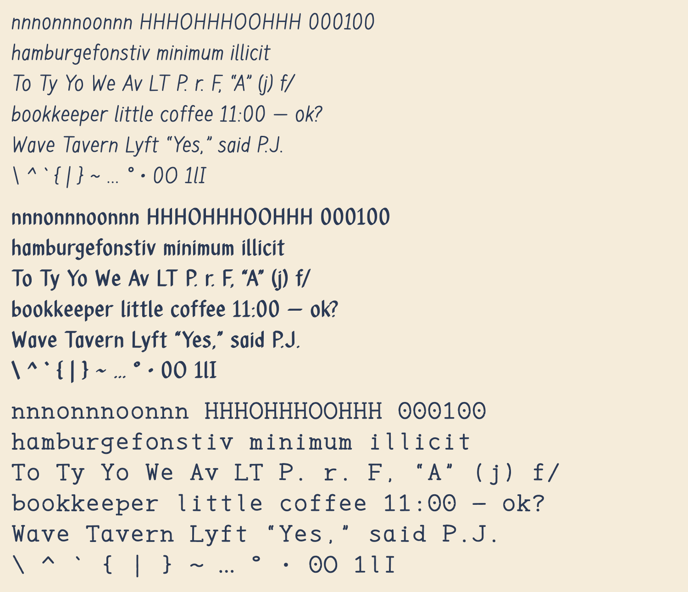

# Pinboard fonts

Three fonts drawn for [Pinboard](https://github.com/zjlgdx/claude-theme-pinboard), a cork-board theme for Claude: **Ballpoint**, **Marker** and **Typewriter**. All three come from one set of letter skeletons (`skeleton.py`), each written with a different pen.



- **Ballpoint**: a fine round pen leaning about 9°. Three drawings of every lowercase letter take turns, so the words read as written, not set.
- **Marker**: a chisel nib held at 35°, thick on the downstrokes and thin across. Upright, with the same alternates.
- **Typewriter**: the same letters with slab serifs, one width for every glyph, struck through an inked ribbon. The zero has a dot.

Each font covers ASCII plus `… ° •`, curly quotes, dashes and a no-break space.

## Use the fonts

The fonts are in `out/`: `.otf` for installing, `.woff2` for the web. On a Mac, double-click an `.otf` and choose Install Font.

```css
@font-face { font-family: 'Pinboard Ballpoint'; src: url(PinboardBallpoint-Regular.woff2) format('woff2'); }
```

## Build them

```
python3 -m venv .venv && .venv/bin/pip install -r requirements.txt
brew install potrace
.venv/bin/python build.py      # out/*.otf and out/*.woff2
.venv/bin/python audit.py      # overshoot, stems, spacing, contours, metrics
.venv/bin/python sheet.py      # out/sheet.png: spacing, kerning and alternates, shaped by Chrome
```

Two scripts serve the Pinboard theme. Each reads the words to draw as JSON on stdin:

- `outline.py` writes those letters as compact SVG outlines, with the fonts' advances and kerning. Claude's desktop app won't load a font inside a backdrop SVG, so Pinboard draws its labels from these paths.
- `subset.py` cuts the fonts down to those letters, as WOFF2 data URIs, for a surface that does load embedded fonts.

## How a glyph is made

1. `skeleton.py` holds each letter's centre line as an SVG path on a 1000-unit canvas, with y pointing down.
2. `build.py` draws that line with a pen on a large bitmap: a round pen, a chisel nib, or a round pen plus slab serifs and ribbon ink.
3. potrace traces the bitmap back into curves, which become a CFF outline.
4. The glyph is spaced from its own profile, kerned against every other glyph, and written out.

## Type-design rules it follows

| Rule | How | Source |
| --- | --- | --- |
| Round shapes overshoot the lines they meet, by 1–3% | Curved parts of a skeleton are pushed 12 units past the baseline, x-height, cap height, ascender and descender. Jitter is kept smaller than that. | [Microsoft: lowercase](https://learn.microsoft.com/en-us/typography/develop/character-design-standards/lowercase), [uppercase](https://learn.microsoft.com/en-us/typography/develop/character-design-standards/uppercase) |
| Horizontals slightly lighter than verticals | The round pens are 7% flatter than round. The chisel nib does this by its angle. | [Typographica: optics in type design](https://typographica.org/on-typography/is-what-i-see-what-i-get-math-and-optics-in-type-design) |
| Space from shape: straight sides get the most, round sides less, open and diagonal sides least | Each side's average white over the x-height (or cap height) zone, at most 15% of the x-height deep, comes off a per-style target. A straight n side is about a third of n's counter, and o comes out at about 0.8 of n. A slanted letter is measured with its lean taken out. | [Glyphs: spacing](https://glyphsapp.com/learn/spacing) |
| Kern after spacing, only where two shapes leave a hole | Closest approach on the rows both letters share, against their spacing sidebearings, half the excess closed. Lowercase pairs capped at −40. | [Glyphs: spacing](https://glyphsapp.com/learn/spacing) |
| Math signs share one width | `+ = < > × ~` are centred in one width. | Fontbakery `math_signs_width` |
| Monospace: one advance for every glyph, narrow letters widened, wide ones squeezed | Typewriter: 600 everywhere, `.notdef` included. `post.isFixedPitch` is set and PANOSE proportion is 9. | [Google Fonts requirements](https://googlefonts.github.io/gf-guide/requirements.html) |
| Tell 0 from O, and 1 from l from I, in a monospace | Typewriter zero has a dot. 1 has a flag and foot, l a tail, I two slabs. | |
| Outer contours counter-clockwise, no overlaps, points at extremes | potrace gives non-overlapping, correctly wound contours. `ExtremaPen` splits every curve at its extremes. No contour is under 400 units². | [Adobe Type 1 spec §3.5, §4.1](https://adobe-type-tools.github.io/font-tech-notes/pdfs/T1_SPEC.pdf), [Glyphs: drawing good paths](https://glyphsapp.com/learn/drawing-good-paths) |
| Vertical metrics | `USE_TYPO_METRICS` is on, hhea equals typo, line gap 0. The line is 1.24 em with the caps centred in it. The win metrics are the font's bounds. | [Google Fonts: vertical metrics](https://googlefonts.github.io/gf-guide/metrics.html), [OpenType: OS/2](https://learn.microsoft.com/en-us/typography/opentype/spec/os2) |
| x-height and cap height | Measured from the flat tops of x (z for Ballpoint) and H. | [OpenType: OS/2](https://learn.microsoft.com/en-us/typography/opentype/spec/os2) |
| Names and versions | Windows names only, IDs 1–6 plus 13/14 for the OFL. head.fontRevision matches nameID 5. post is 3.0, as CFF fonts use. | [OpenType: name](https://learn.microsoft.com/en-us/typography/opentype/spec/name), [recommendations](https://learn.microsoft.com/en-us/typography/opentype/spec/recom) |
| Slanted handwriting | Ballpoint leans 9° as part of the hand, as other script fonts do. It stays a Regular with italicAngle 0, so it needs no upright partner. | Fontbakery `italic_angle` |

The handwriting fonts carry two alternates of every lowercase letter, cycled by `calt`. In "bookkeeper" the two o's, the two k's and the e's are each drawn differently.

## Checks

`fontbakery check-universal` passes all 72 checks on Ballpoint and Marker with no warnings. On Typewriter one check errors: fontbakery 1.1's monospace check reads a `glyf` table, which a CFF font doesn't have. `audit.py` and the build cover what that check would test: one advance, `isFixedPitch`, PANOSE proportion 9, and `xAvgCharWidth`.

The fonts are not hinted. macOS ignores CFF hints, and so does the board's SVG. Run `otfautohint` from the AFDKO before using one as a Windows terminal font.

## Licence

The fonts are under the [SIL Open Font License 1.1](OFL.txt). The build scripts are under the [MIT License](LICENSE).
